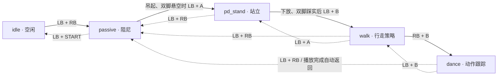

# T800 真机部署与操作（官方 Native SDK）

本分支的现场操作主指南：快速启动、编译下发、进程清理、状态机和常见问题均以本文为入口。模型准备、兼容性和不同实验的参数适配见 [T800 模型准备与适配](README_T800_UNILAB.md)。

本文从 [e1ee107 的现场操作指南](https://github.com/mothinf/engineai_rl_unilab/blob/e1ee107a61b179429da7d94b06daa4c0891f82e6/README_T800_DEPLOY.md)迁入，沿用 **只能从 `walk` 进入 `dance`** 的流程；本分支的状态机配置已同步限制该入口。当前默认策略实现仍为 134→25、50 Hz，现场指南不代表其他观测模型已适配。

## 最简操作流程（SDK 已部署）

适用于配套 SDK、权重和轨迹已完成仿真验收并下发到真机的情况；首次部署见下文第 1～2 节。示例地址 `user@192.168.0.163` 和目录 `~/projects/uni_t800_ppo` 请替换为自己的设备。

**F710 前提：** 下列按键流程要求 SDK 已选中 `gamepad`。本分支输入仲裁目前先尝试 `rc02`，与历史实验版的 F710 独占实现不同；如选中的是 `rc02`，先按文末“F710 完全没有反应”处理输入源，再执行本流程。

1. **开机、解除上电急停**：机器人开机后，用官方 RC02 遥控器按 `BACK + START`，确认进入白灯 / 可运行状态。F710 接收器插在板载 PC，设为 X 模式、MODE 灯灭。
2. **启动自己的 SDK**：机器人获得支撑后，在开发机终端执行下列命令。若提示旧进程仍在运行，先按第 4 节清理，再启动。

   ```bash
   ssh user@192.168.0.163
   sudo systemctl stop robotics.service
   cd ~/projects/uni_t800_ppo
   sudo ./run_robot.sh t800
   ```

3. **先将机器人吊起、摆正**：用吊架将机器人吊起并扶正，双脚保持悬空。F710 松键、摇杆回中，等待输入稳定。
4. **双脚悬空时切 pd_stand**：保持吊架支撑，F710 按 `LB + RB` 进入 `passive`，再按 `LB + A` 进入 `pd_stand`，等待姿态稳定；双脚悬空时可以切入 `pd_stand`，每次切换成功后立即松键。
5. **稍微下放，双脚踩实地面**：保持 `pd_stand`，用吊架缓慢下放一点机器人，让双脚踩实地面，继续保留吊架支撑。
6. **脚踩实后切 walk → dance**：确认双脚已踩实地面，再按 `LB + B` 切到 `walk`；摇杆回中、确认稳定后，按 `RB + B` 开始 `dance`。
7. **随时回 passive，结束后进 idle**：运行中可随时按 `LB + RB` 回到 `passive`；dance 播放完也会自动回到 `passive`。机器人获得支撑后，再按 `LB + START` 进入 `idle`，最后在 SDK 终端按 `Ctrl+C` 退出。

`passive` 仅提供阻尼，不能主动维持站立平衡；保持支撑并保留实体急停。

---

执行顺序：**连接机器人 → 下发 SDK → RC02 解锁 → 清理旧进程并启动 → F710 进入 dance → 退出并清理进程**。

本文保留原指南基于现场记录整理的执行顺序，并将路径、下发方式和输入源说明对齐到当前 `deploy` 分支。真机由 SDK 的 `src_executor` 控制，dance 使用配套的 MNN 策略与 NPZ 轨迹；更换模型先完成配套文档中的准备和验证。

| 操作位置 | 本文使用的地址 / 目录 |
| --- | --- |
| 开发机：本仓库 `deploy` 分支 | `/path/to/engineai_rl_unilab-deploy`（SDK 源码、编译与下发） |
| 真机：板载 PC | `user@192.168.0.163` |
| 真机：部署目录 | `~/projects/uni_t800_ppo` |

地址和远端目录沿用历史设备示例，换设备时替换为对应值；开发机路径改为本分支实际检出目录。所有标注“真机”的命令都在 SSH 登录后的终端执行。

## 1. 连接机器人【开发机】

机器人开机，开发机通过网线或机器人 Wi-Fi 接入机器人网络，然后登录：

```bash
ssh user@192.168.0.163
```

首次部署时创建目录，再退出回到开发机：

```bash
mkdir -p ~/projects/uni_t800_ppo
exit
```

## 2. 编译并下发 SDK【开发机】

首次获取本分支：

```bash
git clone --branch deploy --single-branch https://github.com/mothinf/engineai_rl_unilab.git engineai_rl_unilab-deploy
cd engineai_rl_unilab-deploy
```

已有检出目录时直接进入该目录。先按 [模型准备与仿真验收](README_T800_UNILAB.md)准备配套 MNN、NPZ 和 profile；本分支不附带用户训练的策略。构建环境参考 [SDK 环境说明](README_CN.md)。

在执行下发的开发机终端设置目标，**无需编辑 `install.sh`**：

```bash
export ENGINEAI_REMOTE_USER="user"
export ENGINEAI_REMOTE_HOST="192.168.0.163"
export ENGINEAI_REMOTE_DIR="~/projects/uni_t800_ppo"
```

新开终端需要重新设置这些变量；`ENGINEAI_REMOTE_DIR` 必须是专用的 `~/projects/<name>` 目录。

首次编译或修改 C++ 后，在开发机宿主系统执行以下命令；已有对应编译产物、只更新 MNN / NPZ / YAML 时跳过编译：

```bash
./build.sh -a aarch64 -r humble -t release -j2
```

这里使用 aarch64、ROS Humble；若设备使用 Jazzy，将 `-r humble` 改为 `-r jazzy`。

下发程序与资源：

```bash
./install.sh t800 robot aarch64
```

出现密码提示时，输入真机用户 `user` 的 SSH 密码。脚本会同步程序、T800 资源和启动脚本，并设置真机运行模式。

**目标目录必须专用于这套 SDK**：下发使用 `rsync --delete`，会删除目标目录中不在部署包内的文件。**当前分支没有排除 `logs/`，重新下发前请将要保留的远端日志备份到部署目录之外**。若上一轮程序还在运行，先按第 6 步结束，再重新下发。

程序和资源均未更新时，下次使用直接从第 3 步开始。

## 3. 用 RC02 解除开机急停【机器人现场】

1. 使用官方 RC02 按 `BACK + START` 解除开机急停，按官方流程进入**白灯 / 可运行状态**。
2. 将 Logitech F710 接收器插在真机板载 PC 上；手柄设为 **X 模式，MODE 灯灭**。
3. 松开手柄按键、让摇杆回中，再启动下面的 SDK。

当前仍由 RC02 完成开机解锁，F710 负责随后 SDK 内的状态切换。保留实体急停；首次测试使用吊架或辅助支撑，人员远离动作范围。

## 4. 清理旧进程并启动【真机】

开发机打开 SSH：

```bash
ssh user@192.168.0.163
```

在真机上执行。**清理前让机器人停止运动并获得支撑**；旧 SDK 若仍在前台，先在原终端按 `Ctrl+C`，并关闭官方机器人管理服务 / 网页。

```bash
cd ~/projects/uni_t800_ppo

# 停止官方运控服务，再结束残留进程；没有匹配进程时 pkill 无输出。
sudo systemctl stop robotics.service
sudo pkill -TERM -x src_executor
sudo pkill -TERM -f '(^|/)motor_service_server([[:space:]]|$)'

# 两条命令均无输出后，再执行启动命令。
pgrep -af src_executor
pgrep -af motor_service_server
```

若仍有输出，先处理对应旧进程，见文末“进程冲突”；同一时间只能运行一套运控程序。

```bash
sudo ./run_robot.sh t800
```

保持该终端打开。启动后先松键、摇杆回中，等待输入稳定，再操作 F710。

## 5. 按状态顺序进入 dance【F710】

### 执行阶段状态图

实线为进入 dance 的顺序，虚线为退出或返回路径。`passive` 是阻尼状态，`idle` 是空闲 / 禁用电机控制状态，两者不同。



| 顺序 | 当前状态 → 目标状态 | F710 按键 | 操作说明 |
| --- | --- | --- | --- |
| ① | `idle → passive` | `LB + RB` | 上阻尼，等待使能成功 |
| ② | `passive → pd_stand` | `LB + A` | 先吊起并扶正，双脚悬空时切入，等待姿态稳定 |
| ③ | `pd_stand → walk` | `LB + B` | 保持 pd_stand 稍微下放，双脚踩实地面后切入；摇杆回中 |
| ④ | `walk → dance` | `RB + B` | 开始动作跟踪 |
| ⑤ | `dance → passive` | 无需按键 | 轨迹播放结束自动回到阻尼 |

每次组合键生效后立即松开，再操作下一步。若已经处于 `passive`，从第 ② 步继续。

- **dance 只能从 walk 进入**，不能从 `pd_stand` 直接进入。
- 测试中需要中止动作，按 `LB + RB` 回到 `passive`；软件按键无效时使用实体急停。阻尼状态不会主动维持站立平衡。
- `dance → walk` 也允许用 `LB + B` 手动切回；首次测试中止时优先回 `passive`。
- 本分支 `walk → dance` 为直接切换，没有额外入场插值，第一帧可能产生冲击。

## 6. 结束实验并清理进程【F710 → 真机】

1. 按 `LB + RB` 回到 `passive`（dance 自然结束时已经在此状态）。
2. 确保机器人已获得支撑，再按 `LB + START` 从 `passive` 进入 `idle`。
3. 在运行 SDK 的 SSH 终端按 `Ctrl+C`，然后执行下面的清理命令。

```bash
# 在真机板载 PC 上执行；结束后也要停服务、清理残留。
sudo systemctl stop robotics.service
sudo pkill -TERM -x src_executor
sudo pkill -TERM -f '(^|/)motor_service_server([[:space:]]|$)'

pgrep -af src_executor
pgrep -af motor_service_server
```

两条 `pgrep` 均无输出后，本轮结束。这里清理的是服务与进程，不是磁盘缓存。

再次启动时重复第 3～5 步；现场曾遇到进入 `idle`、退出并重启 SDK 后无法重新上阻尼的问题，处理方法见下文。

## 常见问题

### 进入 idle 或重启 SDK 后，LB + RB 无法上阻尼

现场记录的现象是：`LB + START → idle` 后退出进程，再次启动 SDK 时无法进入阻尼，并出现 IMU 初始化相关输出。尚不能仅凭该现象确定是 idle、重启、使能还是 IMU 链路导致。

先让机器人获得支撑，停止 SDK 并执行第 6 步的进程清理，再用 RC02 按官方流程恢复白灯 / 可运行状态，重新启动 SDK。启动后松键、摇杆回中，再按一次 `LB + RB`。若仍失败，保留完整启动及使能失败日志排查，不要连续按键尝试进入站立。

F710 的 `LB + RB` 是 SDK 的阻尼 / 使能请求，不能代替 RC02 的 `BACK + START` 解除开机急停。

### 已进入 walk，但左摇杆不能控制行走

先看 F710 的 **MODE 灯**。现场曾因误触 MODE 键，导致左摇杆与十字键功能互换；将 MODE 灯切回熄灭，再在可控条件下重试。

### F710 完全没有反应

接收器应插在**运行 SDK 的真机板载 PC**，手柄使用 X 模式、MODE 灯灭。启动或重连后松开所有动作键，摇杆回中，等待输入稳定。

在真机检查设备是否存在：

```bash
ls -l /dev/input/js*
ls -l /dev/input/by-id/
```

确认日志中实际选中的是 `gamepad`；索引取决于注册顺序，例如：

```text
InputCommandArbiterRunner: hardware source 'gamepad' Init succeeded at index ...
```

当前 [输入仲裁源码](src/runner/input_command_arbiter/src/input_command_arbiter_runner.cc)按 `rc02`、`gamepad` 顺序注册，选择首个初始化成功的硬件源并锁定；虚拟手柄还有覆盖通道。因此，日志选中 `rc02` 并不表示运行了旧构建，也不能假定 F710 已接管。

若要采用历史实验的 **F710 独占硬件输入**，在该文件构造函数中移除 `RegisterHardwareSource("rc02", ...)` 注册语句、保留 `gamepad`，重新编译并下发，核对日志实际选中 `gamepad`；虚拟手柄覆盖通道仍然存在，真机实验时不要发送虚拟手柄指令。此修改仅影响 SDK 内输入仲裁，RC02 的开机解锁与硬件急停仍按设备流程使用。本文没有把历史输入源补丁自动迁入，不要在运动中拔插接收器。

### 进程冲突：src_executor / motor_service_server 正在运行

按第 4 步停服务并清理。`src_executor` 优先在原终端用 `Ctrl+C` 结束；`motor_service_server` 还在时，关闭官方机器人管理服务 / 网页，再结束残留进程。

`pkill` 的 `-TERM` 是正常终止请求，执行后仍需以 `pgrep` 无输出为准。若进程持续存在或自动重生，先处理启动它的服务，不要叠加启动新的 SDK。

### SSH / 下发 Connection timed out

确认机器人开机、网线连接正常或开发机已接入机器人 Wi-Fi，然后在开发机执行：

```bash
ip route get 192.168.0.163
ssh user@192.168.0.163
```

SSH 恢复后重新执行 `./install.sh t800 robot aarch64`，无需因为网络中断重新编译。

### 编译时 Docker permission denied

在开发机宿主系统执行一次：

```bash
sudo systemctl enable --now docker
sudo usermod -aG docker "$USER"
newgrp docker
docker ps
```

若仍无权限，完整注销 Ubuntu 桌面后重新登录，再执行 `docker ps`。只新开终端可能不会刷新组权限；不要用 `sudo ./build.sh` 代替权限修复。

### 启动报 libsrc_app.so 找不到

进入真机部署目录，通过脚本启动：

```bash
cd ~/projects/uni_t800_ppo
sudo ./run_robot.sh t800
```

脚本负责 ROS 环境、资源路径和动态库路径。直接运行 `_install/bin/src_executor` 会缺少这些设置。

### 更换 MNN 权重或 NPZ 轨迹

按 [模型准备与适配指南](README_T800_UNILAB.md#adapt-policy)核对观测、关节顺序、scale、PD、控制周期及目标限位，再使用该文的 `scripts/prepare_t800_unilab.py` 转换与检查。本分支不包含旧实验 SDK 的 `convert_unilab_policy_to_mnn.sh`，不要照搬旧转换命令。

当前 `dance` 使用 `param_tag: unilab_motion_tracking`，默认映射到 `assets/config/t800/rl_unilab_motion_tracking/default.yaml`。多模型映射、文件路径和 329/653 等观测扩展也在配套指南说明；模型、轨迹与 profile 应作为一套更新。

仅替换已支持观测的配套 MNN/NPZ/YAML 时可以复用对应 C++ 产物；更改观测代码或输入仲裁则须重新编译。停止旧程序并备份远端日志后重新下发，再重新启动以加载配置。模型找不到时核对 profile 文件名、大小写及实际路径。

### NPZ 报 load_the_npy_file: failed fread

旧版 cnpy 读取 Deflate 压缩 NPZ 可能失败。使用未压缩 **ZIP Stored** 格式（NumPy `np.savez`，不是 `np.savez_compressed`）；怀疑传输损坏时比较两端文件的 `sha256sum`。

本分支 cnpy 对 Unicode 名称数组存在读取限制，数值数组应放在名称元数据之前，并验证 C++ 能完整读取所需字段；仅 Python 检查通过不足以证明 SDK 可加载。`fps` 还应存为 `int32`，具体存储转换见配套模型指南。仅改为未压缩不会修复关节顺序、body 索引或策略与轨迹不匹配的问题。

### 日志提示 direct switch 或重复请求同一状态

`No transitioner for motion [ walk ] to [ dance ], direct switch.` 表示直接切换，没有额外过渡器，不是报错。

持续出现 `Manual Transition requested ... to [same state]` 时，松开组合键；一次状态切换只需按一次。

### 起身、躺下与回退官方版本

起身 / 躺下不属于进入 dance 的必经步骤，按键如下：

| 当前状态 | 按键 | 动作与完成后的状态 |
| --- | --- | --- |
| `passive` | `START + 十字上` | `supine_to_stance` 起身，完成后自动进入 `walk` |
| `walk` | `START + 十字下` | `stance_to_supine` 躺下，完成后自动进入 `passive` |

回退原官方程序时，先按第 6 步停止本次 SDK 并清理进程，再进入保留的官方部署目录启动（以下仅为历史目录示例，使用自己保存的官方目录）：

```bash
cd ~/projects/engineai_robotics
sudo ./run_robot.sh t800
```

本文状态图对应本分支的 `assets/config/t800/task_motion/default.yaml`；原官方版本的 dance 完成后可能回到 `walk`，不要套用本地版本的自动返回规则。

本文于 2026-11-12 迁入 `deploy`，依据本分支脚本与状态配置核对；本次未连接机器人或执行现场动作。原现场记录中的 SDK 补丁、硬件结果不自动代表本分支已验证。
